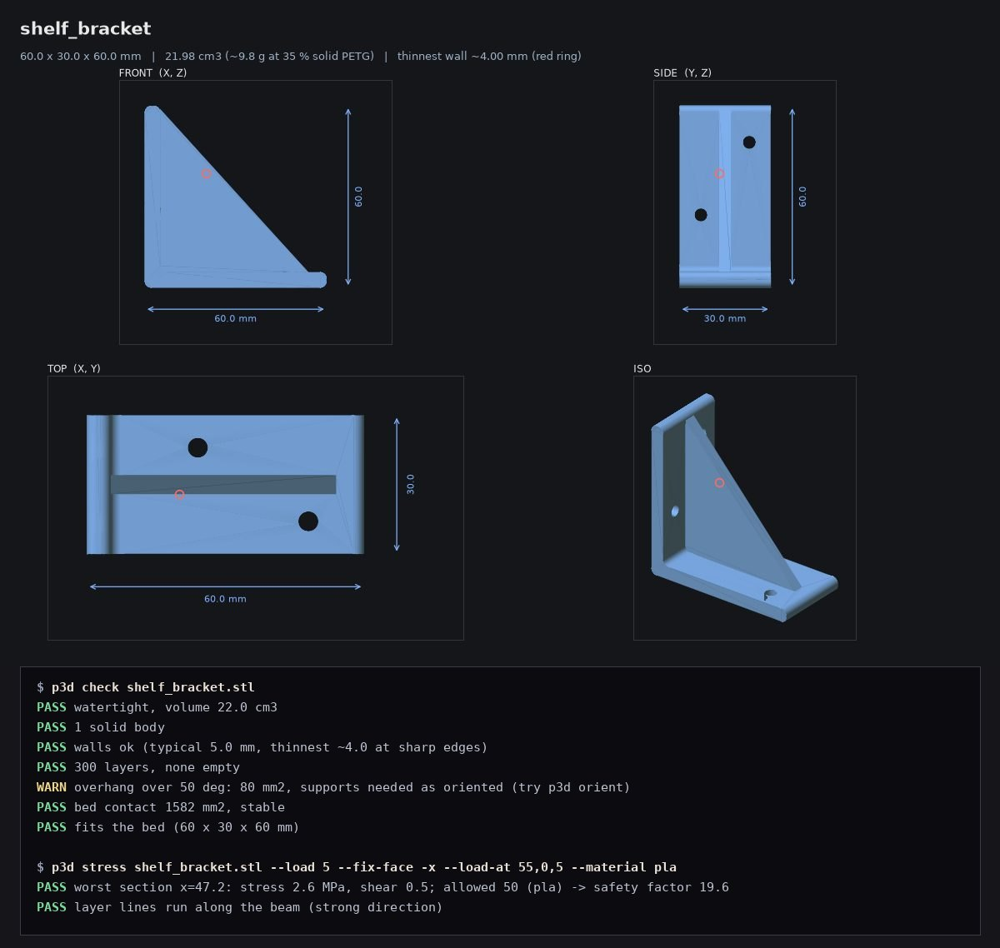
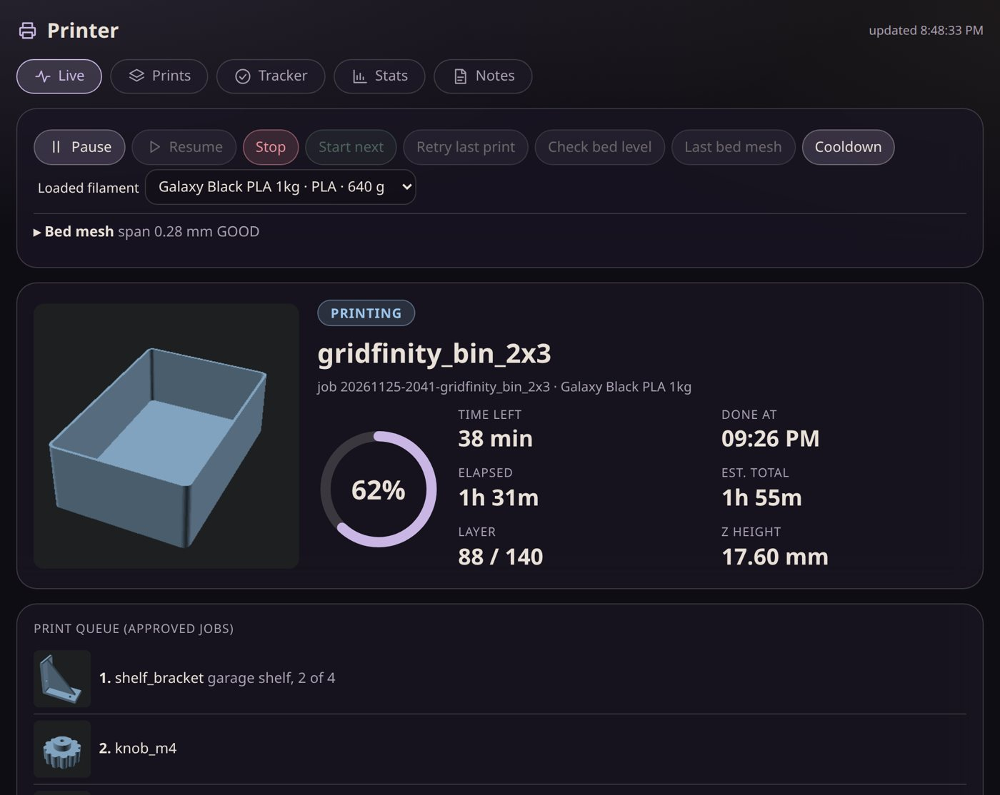
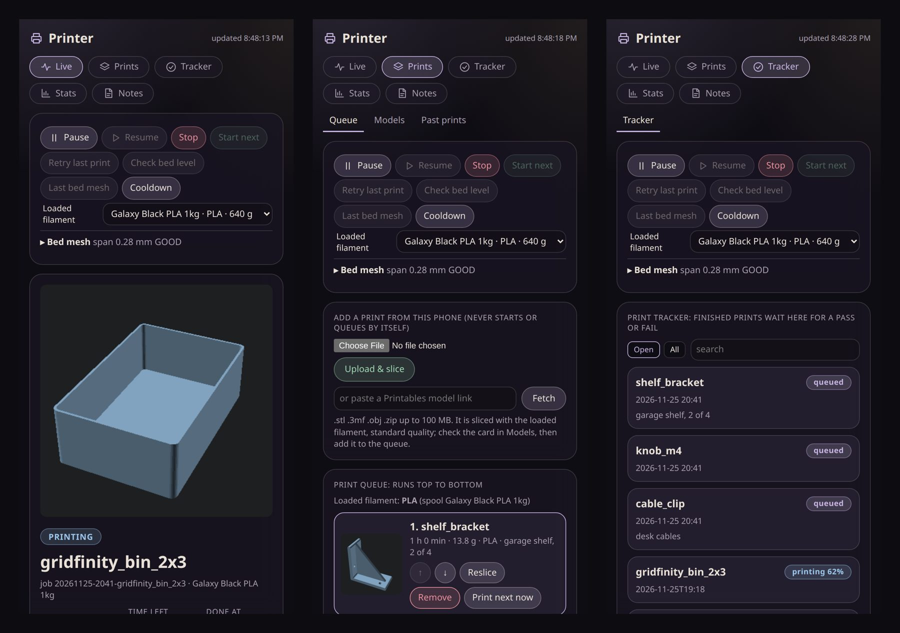
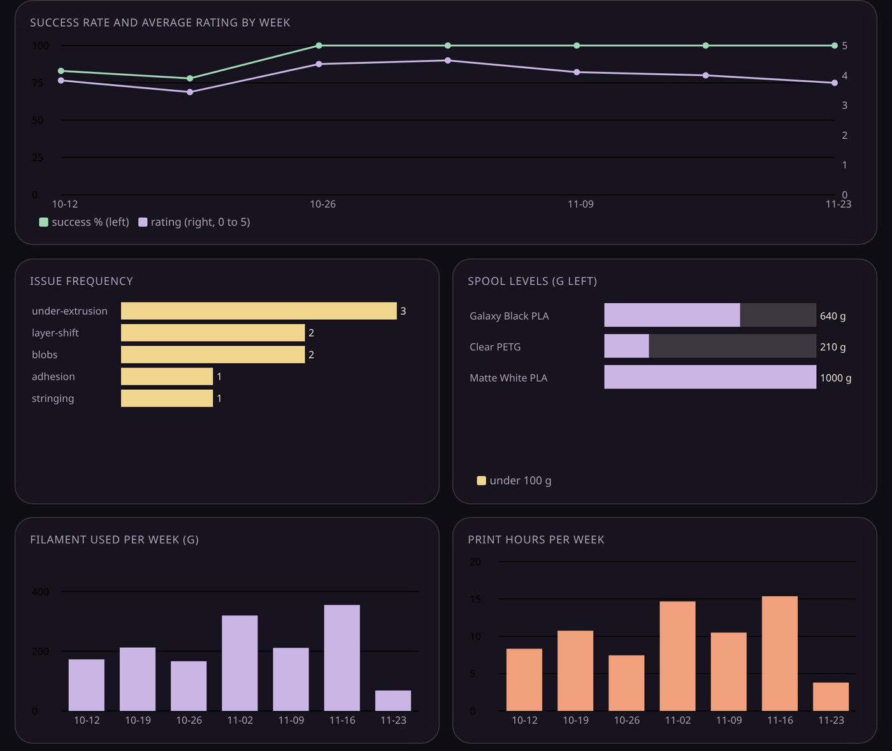

# smart-3d-printer (`p3d`)

**Design it, check it, print it, learn from it.** One open-source tool for your 3D printer: engineering CAD checks
before you slice, Orca Slicer for any of 500+ printers, background printing, a live phone dashboard and a log that
learns what works.

[](https://github.com/Rambo-AI97/smart-3d-printer/actions/workflows/ci.yml)   [](LICENSE)

<p align="center"></p>

## Install (one line)

```bash
curl -fsSL https://raw.githubusercontent.com/Rambo-AI97/smart-3d-printer/main/install.sh | bash
```

It installs p3d with its CAD libraries, downloads Orca Slicer if you don't have it, sets up USB access, then asks
**which printer you have** and how it's connected. Run `p3d doctor` any time: every ✗ line says how to fix it.
By hand: `uv tool install --python 3.12 "p3d[all] @ git+https://github.com/Rambo-AI97/smart-3d-printer"`, then `p3d setup`.

## Use it

```bash
p3d sheet my_part.stl        # 4-view design sheet: sizes, thinnest wall. Approve the shape first
p3d check my_part.stl        # pre-slice gate: watertight, thin walls, overhangs, fits YOUR bed
p3d slice my_part.stl        # -> G-code, time, grams, plus advice (brim? supports? wrong spool?)
p3d print <job>              # prints in the background; close the terminal, it keeps going
p3d web --open               # live dashboard, also on your phone
p3d rate 5                   # after the print, so the log learns what works
```

## Works with your printer

`p3d setup` searches the printer profiles **Orca Slicer ships** (Prusa, Bambu Lab, Creality, Voron, Elegoo,
Anycubic, Sovol, Qidi, Artillery, Flashforge, Snapmaker, UltiMaker, RatRig and more) and takes the bed size,
height and slicer presets from there. `p3d printers ender 3` shows what matches.

| Connection | Printers | Status |
|---|---|---|
| **USB (Marlin)** | Ender-3 / V2 / V3 SE, Prusa MK3, Anycubic, Artillery, Sovol SV06, most stock printers | tested daily on an Ender-3 V3 SE, all features |
| **Klipper (Moonraker)** | Voron, Creality K1 / K2 / Ender-3 V3 KE, Sovol SV08, Elegoo Neptune 4, Qidi, Sonic Pad | new, tested against a simulated printer |
| **OctoPrint** | anything behind OctoPrint | new, tested against a simulated printer |
| **PrusaLink** | Prusa MK4 / MK4S / MK3.9 / XL / MINI / Core One | new, tested against a simulated printer |
| **Bambu Lab (LAN mode)** | X1, P1, A1, H2D | new, tested against a simulated printer |

Every connection gets slicing, printing, pause/resume, cancel, live status, the print log, spools and phone alerts.
Bed leveling, PID tuning, calibration prints and print recovery talk to the firmware directly, so they need USB.
Using a network printer? A report of your first print is the most useful issue you can open.

## Live dashboard

<p align="center"></p>
<p align="center"></p>

Pause, resume, stop, start the next job and re-slice with other settings from your phone; upload a model or paste a
Printables link. Phone alerts through [ntfy](https://ntfy.sh): started, done, failed, cool enough to switch off, spool low.

<p align="center"></p>

Every print is logged with its settings, so the Stats tab can tell you whether a change helped or hurt.

## Engineering tools

| Command | What it answers |
|---|---|
| `p3d sheet` | Does the shape look right? Front, side, top and iso views with sizes and the thinnest wall marked |
| `p3d check` | Will it print? Watertight, one body, thin walls, empty layers, overhangs, bed contact, fits your bed |
| `p3d stress` | Will it hold? Bending and shear from the real mesh against PLA / PETG / TPU strength, layer direction included |
| `p3d orient` | Which side down? Scores every stable face for supports, bed contact, height and strength |
| `p3d coupon` | Will it fit? Slices only the critical section as a minutes-long test print |
| `p3d build` | Parametric parts in Python ([build123d](https://github.com/gumyr/build123d)): fillets, countersunk screws, nut pockets, snap fits, print-in-place hinges, threads |

Try it: `p3d sheet examples/shelf_bracket.py`. Library and workflow: [Shape workflow](docs/shapes.md).

## Safety

1. A print starts only when a person runs `p3d print` or presses a button, never by itself. Clear the bed first.
2. Watch the first layer of every print with new settings or a new filament.
3. Don't leave a printer unattended without a way to cut power. `p3d cancel` stops heaters and motion,
   but it can't fix a part that came loose.
4. The dashboard has Stop and Pause buttons: keep it on your home network or a VPN, never on the open internet.
   Its buttons only work from this computer and the addresses you list in `control_from`.

## More

- [Command reference](docs/commands.md): every command, and how the smart parts work
- [Shape workflow](docs/shapes.md): design sheet, build123d parts library, `p3d build`
- [Data recorded](docs/data.md): log columns, per-print samples, where files live
- [Calibration](docs/calibration.md): which tests, in which order
- [Changelog](CHANGELOG.md)
- Development: `pip install -e ".[dev,cad]"`, `pytest`, `ruff check .`; privacy hook: `git config core.hooksPath .githooks`

Parts made with it are on Printables: [monitor stand](https://www.printables.com/model/1905054),
[stroller cup holder](https://www.printables.com/model/1905061). MIT licence.
