# smart-3d-printer (`p3d`)

Run a USB-connected 3D printer from the command line: slice a model, print it in the background,
watch it on a live phone-friendly dashboard, and keep a log of every print (time, filament, temperatures, your rating).
Simple enough for an AI assistant to drive safely. Tested on a Creality **Ender-3 V3 SE** with stock Marlin firmware.

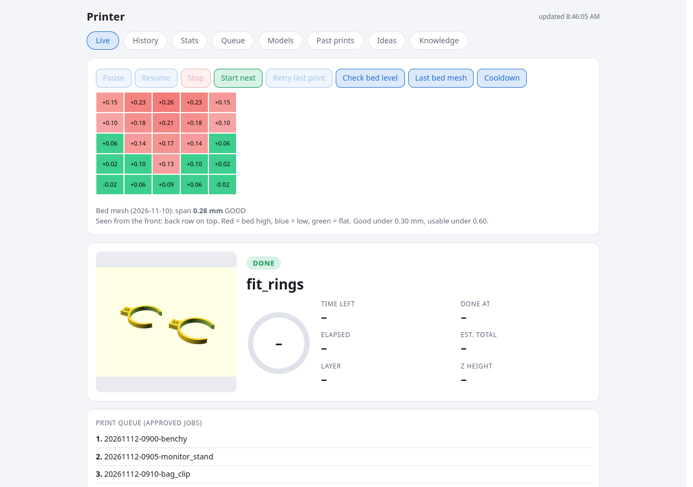 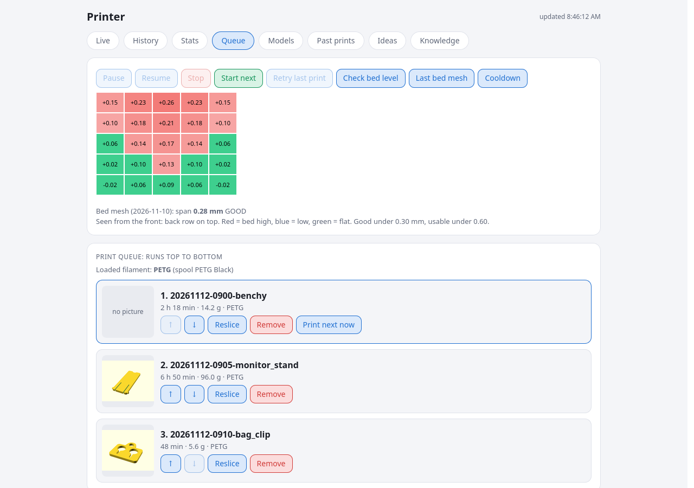 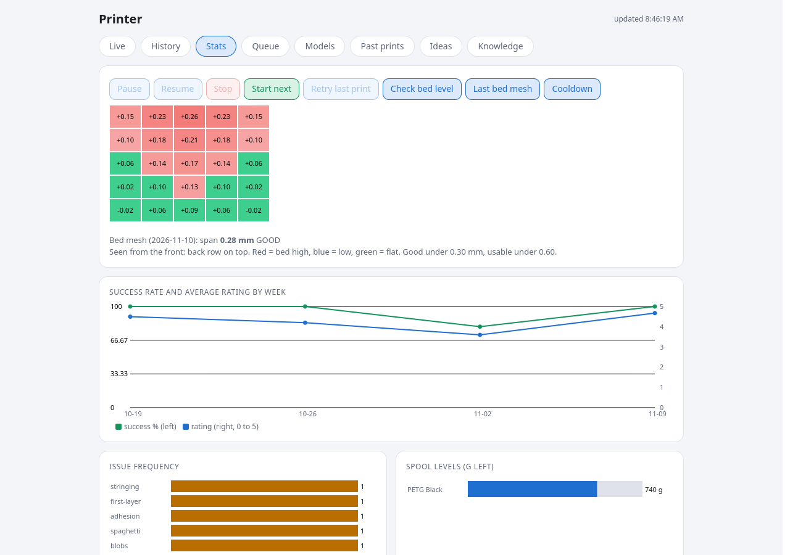

## Quick start

You need Linux, Python 3.11+, [pipx](https://pipx.pypa.io), [Orca Slicer](https://github.com/SoftFever/OrcaSlicer/releases)
(the AppImage is fine) and, optionally, [OpenSCAD](https://openscad.org) for parts and previews.

1. **Install:** `pipx install git+https://github.com/Rambo-AI97/smart-3d-printer`
2. **Set up:** plug in the printer, switch it on, run `p3d setup` (finds the port and the slicer, asks for optional phone alerts).
3. **Check:** `p3d install-service`, then `p3d doctor`. Fix any ✗ line it shows (it tells you how).
4. **Slice:** `p3d slice my-part.stl` → prints the G-code path, time and grams.
5. **Print:** clear the bed, then `p3d print <that .gcode>`. Watch with `p3d web --open` or `p3d status`.

After the print: `p3d rate 5` (or `p3d rate 2 --issues stringing`) so the log learns what works.

## Commands

| Group | Command | What it does |
|---|---|---|
| Print | `p3d status [--json]` | current job, progress, temperatures |
| | `p3d print FILE.gcode` | print in the background (survives closing the terminal) |
| | `p3d print FILE --pause-at-layer N` | pause before layer N (magnets, colour swap); `--force` ignores a low spool |
| | `p3d pause [--at-layer N \| --remove-layer N \| --clear]` / `p3d resume` | host-side pause at a layer change (retract, lift, park, heaters stay on); `--remove-layer`/`--clear` cancel pending layer pauses mid-print |
| | `p3d cancel` | safe stop: heaters off, lift, park |
| | `p3d queue add JOB \| list \| remove N \| move N M \| next` | queue of approved jobs; `next` starts the head (refuses while printing or when the spool is short) |
| | `p3d wait layer\|done` | block until the first layer is down / the job ends (for scripts) |
| | `p3d retry` / `p3d cooldown` | reprint the newest logged job / after a print: wait until cool, motors off, alert |
| | `p3d web [--open]` | live dashboard URL (also for your phone) |
| Design | `p3d slice MODEL [-q draft\|standard\|fine] [-f pla\|petg] [--supports] [--brim]` | model → G-code |
| | `p3d scad NAME` | OpenSCAD part → STL + preview |
| | `p3d model FILE` / `p3d game PRESET` | any .glb/.obj/.fbx/.stl → solid printable STL (Blender); a Godot game model by preset |
| | `p3d inspect JOB_DIR\|FILE.gcode` | where the time and filament go, plus slice advice (brim, supports, heavy settings, placement, spool) |
| | `p3d pack NAME` | upload pack for Printables (STL, source, render) |
| | `p3d recover JOB [--from-layer N \| --z MM]` | continue a failed print from its last good layer (writes a job, never prints) |
| | `p3d addon MODEL --on-z MM [--x --y]` | slice a model to print on top of an existing part (writes a job, never prints) |
| Calibrate | `p3d level [--hot 70]` | probe the bed, colour map, what to adjust |
| | `p3d calib temp\|retraction\|flow\|firstlayer` | make a calibration print |
| | `p3d pid` / `p3d probe` | PID-tune heaters / read-only firmware check |
| Data | `p3d log`, `p3d history`, `p3d rate` | job log, totals, ratings (issue tags print a concrete next step) |
| | `p3d import-history` | add past G-code files found on this PC to the log |
| | `p3d suggest`, `p3d stats` | recurring issues with fixes; success, rating, grams, hours per week and when settings changed |
| | `p3d spool add\|list\|use\|set` | filament spools; grams are deducted when a job ends (done = all, stopped = share printed) |
| | `p3d idea add\|list\|move\|done` | print ideas in a hand-editable `ideas.md` |
| Setup | `p3d setup`, `p3d doctor`, `p3d install-service` | first run, health check, background services |

### Smart features

- **Slice advisor:** runs after every `p3d slice`, `p3d queue add` and dashboard (re)slice, and at the end of `p3d inspect`; it flags problems before you print (tall part without brim, support-heavy or unused supports, heavy walls/infill on a small part, off-centre or bad-mesh placement, filament vs active spool, long fine prints); thresholds are constants in `advisor.py`, `advise(info)` is reusable.
- **Bed step-down:** PETG first layer 70 C, then 60 C (PLA 60/55); set in `flatten_profile.py`, applied to every plate variant.
- **Pause/resume** works on stock Marlin: the sender stops at a layer boundary, retracts, lifts and parks; resume returns, primes and carries on. The dashboard and the ntfy message have Pause/Resume buttons (POST `/api/pause`, `/api/resume`).
- **Recover / add-on:** the Ender-3 V3 SE probes Z with the nozzle at one point (config `z_home_xy`, default bed centre). If the part's footprint covers that point, or is unknown, the generated job never probes Z: you lower the nozzle onto the part top by hand and the job declares that height (`G92 Z`), then homes X/Y only. If the footprint is known and clear (+ `z_home_margin`), it uses a normal `G28`. Both write `INSTRUCTIONS.txt` next to the G-code and need `p3d print --confirm-z`. Untested on hardware until watched once.
- **Stats:** every job stores a settings snapshot (layer height, temperatures incl. the bed step-down, speeds, walls, infill, retraction, profile hash); the dashboard Stats tab charts success and rating by week, issues, grams and hours, spool levels and a settings-change timeline.
- **Dashboard controls:** a bar on every tab with Pause, Resume, Stop, Start next, Retry last print (`p3d retry`), Check bed level (one `p3d level --hot 70` probe as a background task, colour map when done; refused while a print runs or cools), Last bed mesh and Cooldown. Queue, history and model cards have a Reslice form (filament, quality, walls, infill, brim, supports, keep orientation, optional pause at layer N with a note); the result shows time, grams and a preview with Add to queue. The Knowledge tab renders and edits the hub's rules, filament guide, printer lessons and ideas files (fixed allowlist, atomic save, `.bak` of the previous version). All writes are limited to `control_from` addresses.
- **Control endpoints** (`/api/cancel`, `pause`, `resume`, `queue/next`, `ideas`) accept localhost plus the addresses in `cancel_from` / `control_from` in the config. The queue lives in `print_queue.json` and spools in `spools.json` in the data dir; the ideas board is `ideas.md` next to it (`ideas_file` to move it).
- **Loud alerts**: set `urgent_ntfy_url` to a second ntfy topic your phone lets through silent mode. Print done, printer cool, failed/cancelled, paused, still warm, not started and spool low also go there with `Priority: 5`, only between `urgent_hours` (default `[7, 22]`, local time). Set `quips_file` (lines under `[print_start]`, `[print_done]`, `[print_failed]`) to put a funny line above the facts. Test with `p3d notify-test --dry-run` (prints, sends nothing) or `p3d notify-test`.

`p3d --help` lists everything; `p3d <command> -h` explains one command.

## Works with

- **Ender-3 V3 SE (stock Marlin, USB):** tested daily. Bundled Orca profiles are tuned for it (0.4 mm nozzle, PLA and PETG).
- **Other Marlin printers over USB:** the sender speaks plain Marlin (line numbers, checksums, resend), so it should work.
  Change three things: the slicer profiles (`p3d profiles` after editing the preset names in
  `src/p3d/flatten_profile.py`, or drop your own Orca CLI profiles in `~/.config/p3d/profiles/`),
  `park_y` in the config (your bed depth), and check `p3d probe` answers. Run your first print watched.
- **Klipper:** not supported. Klipper printers are driven through Moonraker, not a raw serial port;
  use Mainsail/Fluidd there. (On the V3 SE, Klipper also disables the stock screen and the auto Z-offset.)

## Safety rules

1. Never start a print unless a person said "print it" **and** confirmed the bed is clear.
2. Watch the first layer of every print with new settings or a new filament.
3. Don't leave a printer unattended without a way to cut power. `p3d cancel` stops heaters and motion,
   but it can't fix a part that came loose: switch the printer off.
4. The dashboard is read-only on purpose. Keep it on your home network or a VPN, never on the open internet.

## Models

Parts designed and printed with this tool, CC BY-SA 4.0. Sources in `models/scad/`:
`p3d scad NAME` renders one, `p3d slice` slices it. Published on Printables:
[monitor stand](https://www.printables.com/model/1905054), [stroller cup holder](https://www.printables.com/model/1905061).

**Kitchen**

| 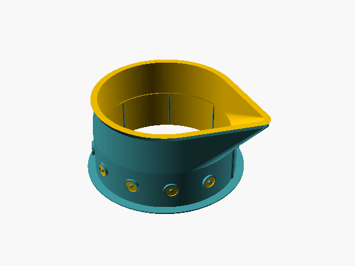 | 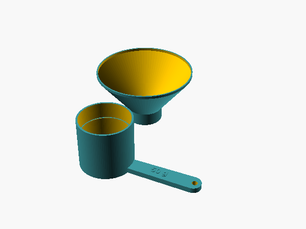 | 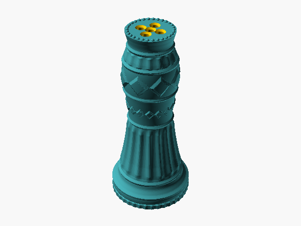 | 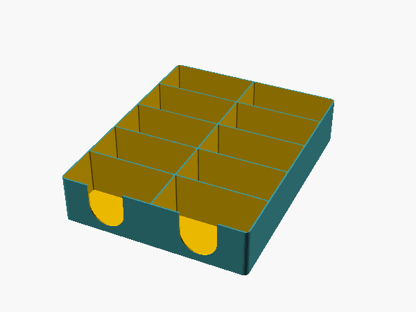 | 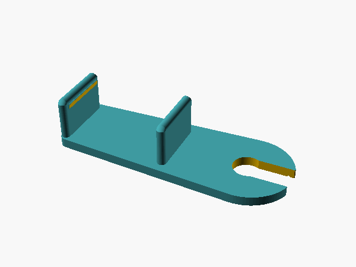 |
|---|---|---|---|---|
| [Grinder pour collar](models/scad/grinder_funnel.scad) | [Coffee scoop + funnel](models/scad/coffee_scoop.scad) | [Salt & pepper shakers](models/scad/shakers.scad) | [Tea bag box](models/scad/tea_box.scad) | [Sink brush holder](models/scad/sink_brush_holder.scad) |

**Baby & stroller**

| 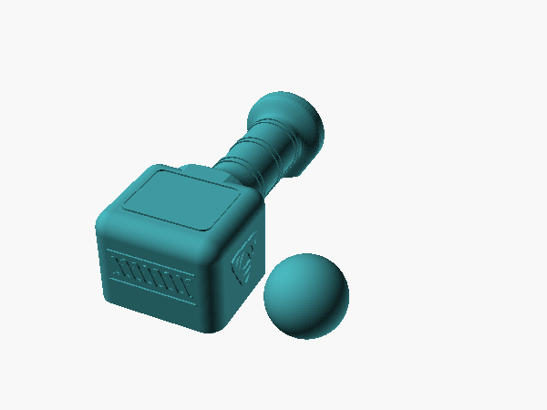 | 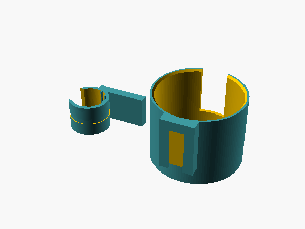 | 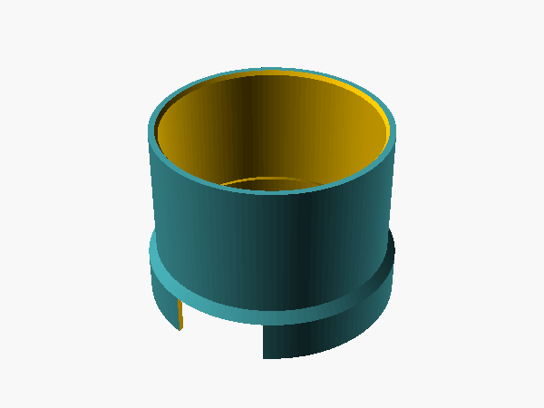 | 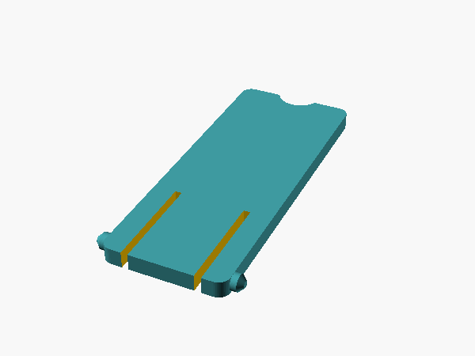 |
|---|---|---|---|
| [Rattle (V4, prints lying down)](models/scad/baby_rattle_v4.scad) | [Stroller cup holder](models/scad/stroller_cup.scad) | [Tall-bottle extension](models/scad/stroller_cup_ext.scad) | [Baby monitor kickstand](models/scad/monitor_stand.scad) |

**Dog walks**

| 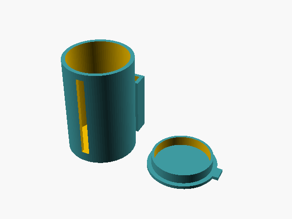 | 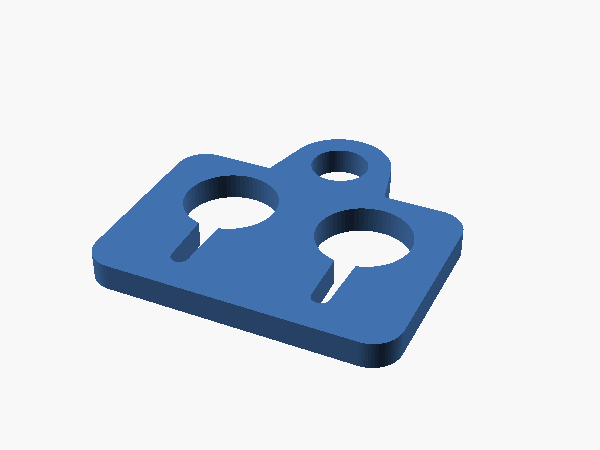 | 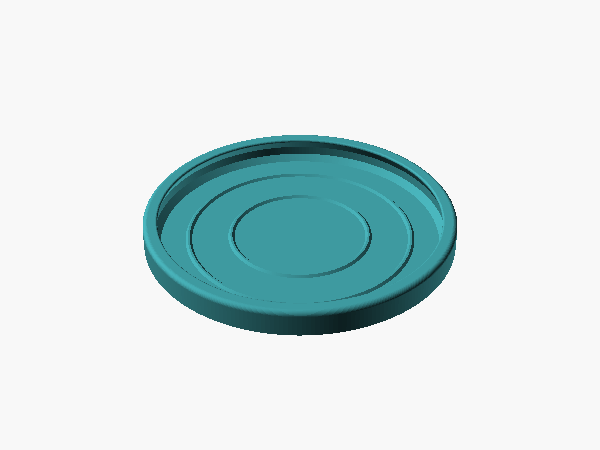 |
|---|---|---|
| [Bag roll holder (leash)](models/scad/bag_holder.scad) | [Used-bag clip](models/scad/bag_clip.scad) | [Frisbee](models/scad/dog_frisbee.scad) |

**Desk & everyday**

| 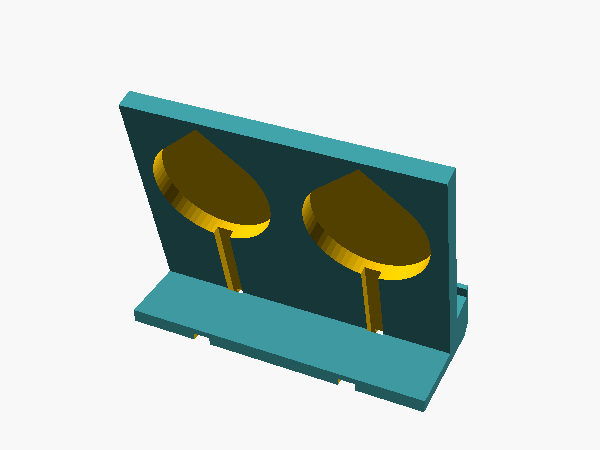 | 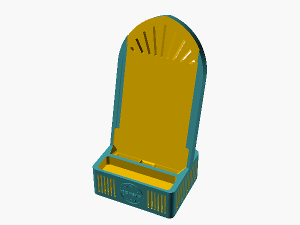 | 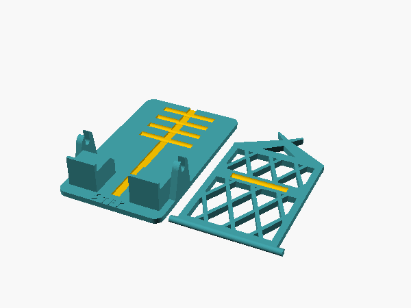 | 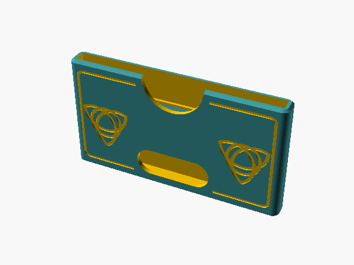 | 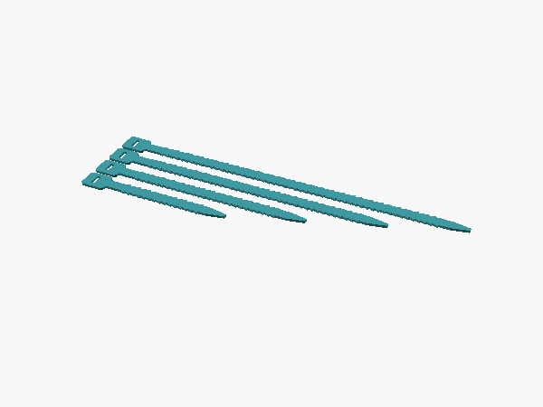 | 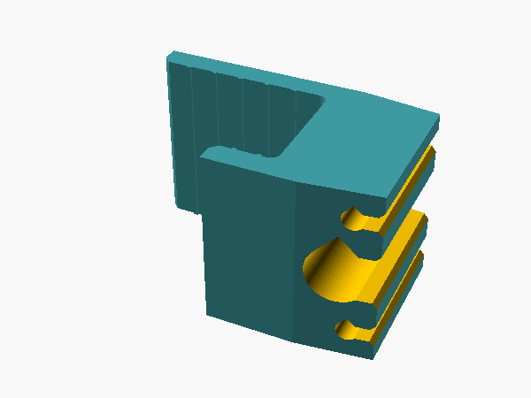 |
|---|---|---|---|---|---|
| [Phone dock](models/scad/phone_dock.scad) | [Cathedral radio dock](models/scad/radio_dock.scad) | [Stave phone stand (4 angles)](models/scad/stave_stand.scad) | [6-card wallet](models/scad/card_wallet.scad) | [Cable clips](models/scad/cable_clips.scad) | [Table-edge cable clip](models/scad/edge_cable_clip.scad) |

**Printer tools**

| 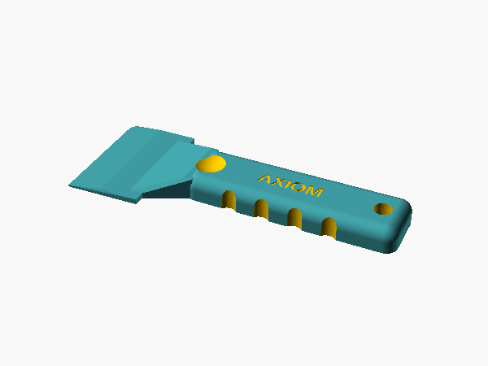 | 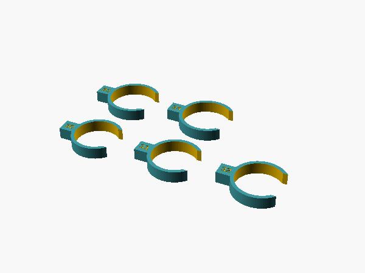 |
|---|---|
| [Bed scraper](models/scad/bed_scraper.scad) | [Fit-test rings](models/scad/fit_rings.scad) |

## More

- [Changelog](CHANGELOG.md): what changed in each version
- [Data recorded](docs/data.md): log columns, per-print samples, where files live
- [Calibration](docs/calibration.md): which tests, in which order, and the values found
- [Game models](docs/game-models.md): turning a Godot/Blender model into a printable STL
- Development: `pip install -e ".[dev]"`, `pytest`, `ruff check .`; enable the privacy hook once with
  `git config core.hooksPath .githooks`

MIT licence.
