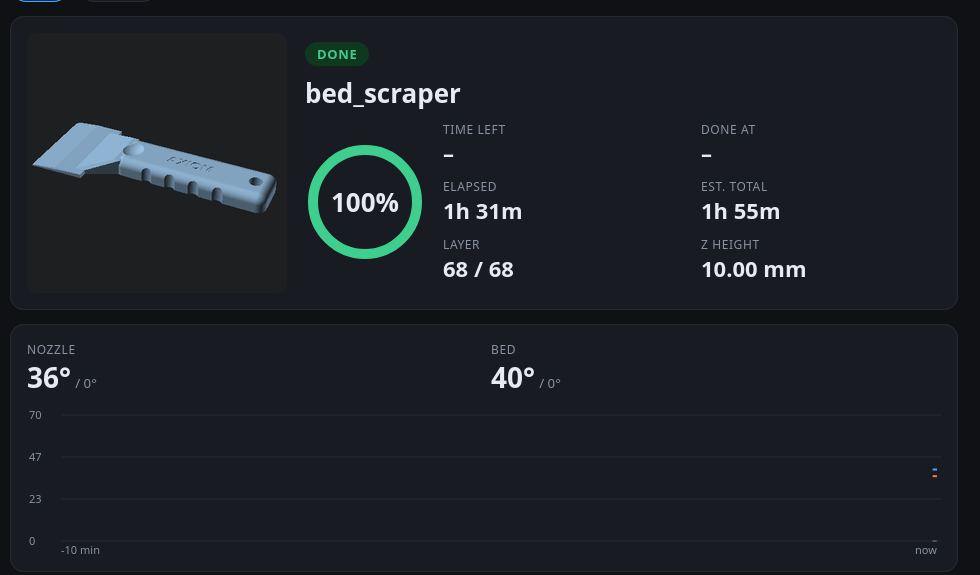

# smart-3d-printer (`p3d`)

Run a USB-connected 3D printer from the command line: slice a model, print it in the background,
watch it on a live phone-friendly dashboard, and keep a log of every print (time, filament, temperatures, your rating).
Simple enough for an AI assistant to drive safely. Tested on a Creality **Ender-3 V3 SE** with stock Marlin firmware.

## Quick start

You need Linux, Python 3.11+, [pipx](https://pipx.pypa.io), [Orca Slicer](https://github.com/SoftFever/OrcaSlicer/releases)
(the AppImage is fine) and, optionally, [OpenSCAD](https://openscad.org) for parts and previews.

1. **Install:** `pipx install git+https://github.com/Rambo-AI97/smart-3d-printer`
2. **Set up:** plug in the printer, switch it on, run `p3d setup` (finds the port and the slicer, asks for optional phone alerts).
3. **Check:** `p3d install-service`, then `p3d doctor`. Fix any ✗ line it shows (it tells you how).
4. **Slice:** `p3d slice my-part.stl` → prints the G-code path, time and grams.
5. **Print:** clear the bed, then `p3d print <that .gcode>`. Watch with `p3d web --open` or `p3d status`.

After the print: `p3d rate 5` (or `p3d rate 2 --issues stringing`) so the log learns what works.

## Commands

| Group | Command | What it does |
|---|---|---|
| Print | `p3d status [--json]` | current job, progress, temperatures |
| | `p3d print FILE.gcode` | print in the background (survives closing the terminal) |
| | `p3d cancel` | safe stop: heaters off, lift, park |
| | `p3d wait layer\|done` | block until the first layer is down / the job ends (for scripts) |
| | `p3d web [--open]` | live dashboard URL (also for your phone) |
| Design | `p3d slice MODEL [-q draft\|standard\|fine] [-f pla\|petg] [--supports] [--brim]` | model → G-code |
| | `p3d scad NAME` | OpenSCAD part → STL + preview |
| | `p3d inspect FILE.gcode` | where the time and filament go |
| | `p3d pack NAME` | upload pack for Printables (STL, source, render) |
| Calibrate | `p3d level [--hot 70]` | probe the bed, colour map, what to adjust |
| | `p3d calib temp\|retraction\|flow\|firstlayer` | make a calibration print |
| | `p3d pid` / `p3d probe` | PID-tune heaters / read-only firmware check |
| Data | `p3d log`, `p3d history`, `p3d rate` | job log, totals, ratings |
| Setup | `p3d setup`, `p3d doctor`, `p3d install-service` | first run, health check, background services |

`p3d --help` lists everything; `p3d <command> -h` explains one command.

## Works with

- **Ender-3 V3 SE (stock Marlin, USB):** tested daily. Bundled Orca profiles are tuned for it (0.4 mm nozzle, PLA and PETG).
- **Other Marlin printers over USB:** the sender speaks plain Marlin (line numbers, checksums, resend), so it should work.
  Change three things: the slicer profiles (`p3d profiles` after editing the preset names in
  `src/p3d/flatten_profile.py`, or drop your own Orca CLI profiles in `~/.config/p3d/profiles/`),
  `park_y` in the config (your bed depth), and check `p3d probe` answers. Run your first print watched.
- **Klipper:** not supported. Klipper printers are driven through Moonraker, not a raw serial port;
  use Mainsail/Fluidd there. (On the V3 SE, Klipper also disables the stock screen and the auto Z-offset.)

## Safety rules

1. Never start a print unless a person said "print it" **and** confirmed the bed is clear.
2. Watch the first layer of every print with new settings or a new filament.
3. Don't leave a printer unattended without a way to cut power. `p3d cancel` stops heaters and motion,
   but it can't fix a part that came loose: switch the printer off.
4. The dashboard is read-only on purpose. Keep it on your home network or a VPN, never on the open internet.

## Models

Parts designed and printed with this tool (OpenSCAD sources in `models/scad/`), CC BY-SA 4.0:

- [Monitor stand](https://www.printables.com/model/1905054)
- [Stroller cup holder](https://www.printables.com/model/1905061)

## More

- [Data recorded](docs/data.md): log columns, per-print samples, where files live
- [Calibration](docs/calibration.md): which tests, in which order, and the values found
- [Game models](docs/game-models.md): turning a Godot/Blender model into a printable STL
- Development: `pip install -e ".[dev]"`, `pytest`, `ruff check .`; enable the privacy hook once with
  `git config core.hooksPath .githooks`

MIT licence.
